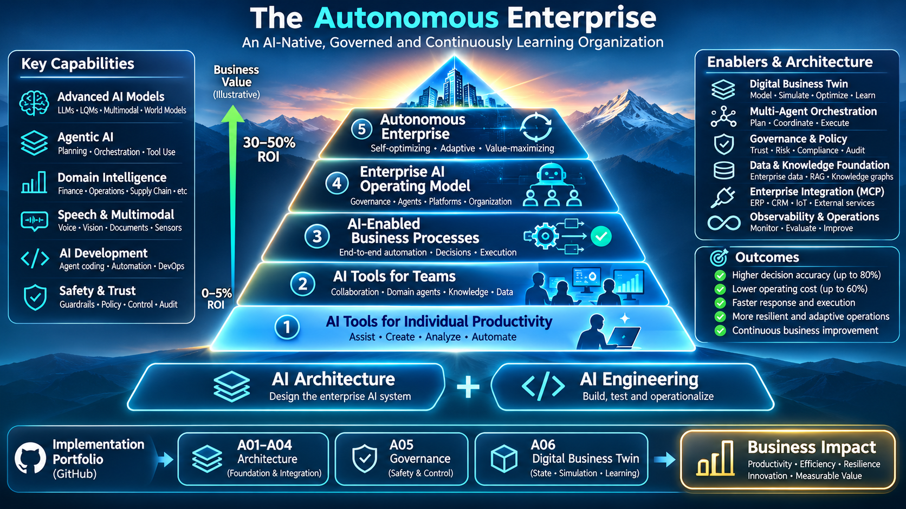

# Christian Grant

### Enterprise AI Architect · AI Engineer · Autonomous Enterprise Systems

**Design · Build · Transform**

Designing AI-native enterprise architectures, building and validating their technical foundations, and exploring how organizations can operate with progressively greater — and governed — autonomy.

📍 Copenhagen, Denmark · 🌐 [DeepAIMind](https://deepaimind.com)

---

## From Enterprise AI to the Autonomous Enterprise

*An exploratory maturity model — not a claim that every organization follows the same path. Business value depends on the use case, integration quality, controls and measurable outcomes.*

The goal is to connect **enterprise architecture**, **hands-on AI engineering**, and **operational business transformation**. Architecture defines how systems fit together. Engineering turns designs into measurable implementations. Autonomous Enterprise projects explore how those capabilities improve real business decisions and operations.

## Three connected project programmes

| Programme | Principle | Focus | Outcome |
|:--|:--|:--|:--|
| **AI-A — DESIGN** | Architect | Enterprise AI reference architectures, agents, knowledge, integration and governance | Systems that can be understood, integrated and governed |
| **AI-E — BUILD** | Engineer | Models, training, fine-tuning, evaluations, inference and deployment | Working, tested and measurable AI components |
| **AI-X — TRANSFORM** | Autonomous Enterprise | Operating models, Digital Business Twins, business processes and decision intelligence | Progressively autonomous, accountable business operations |

---

## AI-A — Enterprise AI Architecture

A connected series of architecture projects, each with documented technical decisions, diagrams and focused proof-of-concept work.

| ID | Project | Status |
|:--|:--|:--|
| **AI-A01** | [Enterprise AI Reference Architecture](https://github.com/cpgrant/a-01-enterprise-ai-architecture) | Published |
| **AI-A02** | [Agent Orchestration & A2A](https://github.com/cpgrant/a-02-agent-orchestration-a2a) | Published |
| **AI-A03** | [Enterprise RAG & Knowledge](https://github.com/cpgrant/a-03-enterprise-knowledge-rag) | Published |
| **AI-A04** | [MCP & Enterprise Integration](https://github.com/cpgrant/a-04-mcp-enterprise-integration) | Published |
| **AI-A05** | AI Governance & Policy Enforcement | Planned |
| **AI-A06** | Digital Business Twin Architecture | Planned |

**Architecture direction:** trustworthy enterprise AI spanning data and knowledge, agents, tools, workflows, governance, observability and operational feedback.

## AI-E — AI Engineering

Practical experiments in the foundations and operation of modern AI, from model internals through training and serving.

| ID | Project | Focus |
|:--|:--|:--|
| AI-E01 | Transformer from Scratch | Attention, embeddings, model architecture |
| AI-E02 | Mini-LLM from Scratch | Tokenization, training, generation |
| **AI-E03** | [LoRA / QLoRA Fine-Tuning](https://github.com/cpgrant/03-lora-qlora-finetuning) | Parameter-efficient training and GPU benchmarking |
| AI-E04–E08 | Preference optimization, evaluations, guardrails, quantization, distillation | Alignment, validation and efficiency |
| AI-E09–E12 | Multimodal sensor AI, synthetic data, DeepSpeed, deployment | Applied AI and operations |

*The AI-E identifiers are portfolio labels; existing repository names do not need to change. Only projects with verified public links are linked here.*

## AI-X — Autonomous Enterprise

A **planned ten-project applied-business programme** that brings architectural and engineering capabilities together into organizational operating models and working demonstrations.

| ID | Proposed project | Business capability |
|:--|:--|:--|
| **AI-X01** | Autonomous Enterprise Operating Model | Organization, roles, decision rights, human oversight |
| **AI-X02** | Business State & Digital Business Twin | Live state, events, metrics, simulation |
| **AI-X03** | Autonomous Strategy & Planning | Objectives, scenarios, resource allocation |
| **AI-X04** | AI-Native Organization & Management | Agent teams, delegation, escalation |
| **AI-X05** | Autonomous Finance | Forecasting, controls, finance workflows |
| **AI-X06** | Autonomous Operations | Enterprise processes, workflow orchestration |
| **AI-X07** | Autonomous Customer & Revenue | Sales, marketing and customer operations |
| **AI-X08** | Enterprise Decision Intelligence | Recommendations, risk, approval and optimization |
| **AI-X09** | Autonomous Learning Enterprise | Outcomes, evaluation and learning loops |
| **AI-X10** | Integrated Autonomous Enterprise Prototype | End-to-end governed demonstration |

*AI-A06 focuses on Digital Business Twin architecture; AI-X02 focuses on its operational application.*

---

## Selected working systems

- **[Autobiz](https://github.com/cpgrant/autobiz)** — experimental autonomous-enterprise platform for business operations, agents and operational loops.
- **[ClarityClaw](https://github.com/cpgrant/clarityclaw)** — agent runtime and orchestration with attention to controlled execution and traceability.
- **[MacShell](https://github.com/cpgrant/macshell)** — local AI shell assistant for macOS with confirmation and safety checks.

## Background & research

My work draws on enterprise architecture, distributed systems, data infrastructure, AI strategy and hands-on engineering, including experience across consulting and industry with **DeepAIMind, Deloitte, Maersk and Oticon**.

At [DeepAIMind](https://deepaimind.com), I explore **Digital Business Twins, AI-native operating models, governed autonomy and the evolution of autonomous enterprises**.

**Engineering principle:** *Architecture should be implementable. Engineering should be measurable. Autonomy should be governed.*

---

[DeepAIMind](https://deepaimind.com) · [GitHub](https://github.com/cpgrant)
